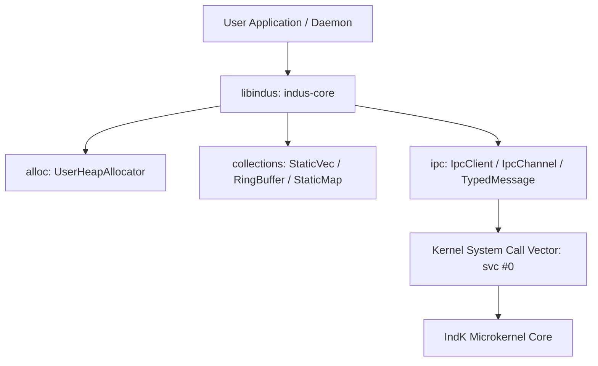

# Ind OS Core Userspace Libraries Specification
**Document ID:** `INDOS-SPEC-LIB-01`  
**Phase:** Phase 5 (Userspace & the Developer OS)  
**Sprint:** SP-33  
**Status:** RATIFIED FOR SP-33  
**Requirements Traceability:** `REQ-USE-202`  
**Target Invariants:** `INV-LIB-001` (Safe Bounded `no_std` Allocation & Collections), `INV-LIB-002` (Capability-First IPC Ergonomics with Zero Ambient Authority)

---

## 1. Executive Summary & Purpose

`INDOS-SPEC-LIB-01` establishes `libindus` (`indus-core`), the fundamental userspace foundation library for Ind OS. All userspace daemons, system servers, drivers, and interactive applications compile against `libindus`.

Per `REQ-USE-202`, `libindus` must provide:
1. **`no_std`-Friendly Allocator & Memory Primitives:** Bounded heap management and user memory pools without external crate dependencies.
2. **Deterministic Bounded Collections:** Pre-allocated, panic-free data structures (`StaticVec`, `RingBuffer`, `StaticString`, `StaticMap`) suitable for critical system services.
3. **Capability-First Ergonomic IPC Bindings:** High-level, safe, zero-copy Rust client abstractions over low-level `SYS_IPC_*` syscalls that require presenting valid `Capability` tokens for every operation (`INV-LIB-002`).
4. **Zero Ambient Authority Enforcement:** Process handles cannot invoke system resources without explicit capability delegation.

---

## 2. Architecture & Modules



### 2.1 Module Decomposition
- `indus_core::alloc`: Bounded heap allocation and block management.
- `indus_core::collections`:
  - `StaticVec<T, N>`: Fixed-capacity vector without runtime heap allocations.
  - `RingBuffer<T, N>`: Bounded FIFO queue with push/pop semantics.
  - `StaticString<N>`: Fixed-size UTF-8 string wrapper.
  - `StaticMap<K, V, N>`: Linear probing key-value associative array.
- `indus_core::ipc`:
  - `IpcClient`: Client handle managing connection to service endpoints.
  - `IpcChannel`: Request/response conversational protocol.
  - `TypedMessage`: Strongly typed message serialization and payload framing.
  - `CapabilityToken`: Client capability wrapper enforcing rights check prior to transmission.

---

## 3. Capability-First IPC Ergonomics (`INV-LIB-002`)

In Ind OS, raw integer file descriptors and ambient communication sockets are forbidden. `IpcClient` encapsulates a verified `CapabilityToken`:

```rust
pub struct IpcClient {
    endpoint_id: u32,
    cap: CapabilityToken,
}

impl IpcClient {
    pub fn new(endpoint_id: u32, cap: CapabilityToken) -> Self {
        Self { endpoint_id, cap }
    }

    pub fn call(&self, request: &IpcMessage, response: &mut IpcMessage) -> Result<(), IpcError> {
        if !self.cap.rights().contains(CapRights::WRITE) {
            return Err(IpcError::PermissionDenied);
        }
        // Dispatches through SYS_IPC_CALL presenting cap.handle()
        ...
    }
}
```

---

## 4. Documentation & Examples

Comprehensive API usage documentation and examples are published in `userspace/libindus/README.md`.
