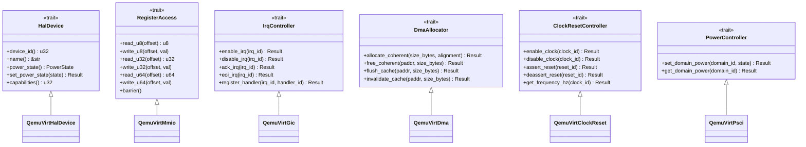

# Ind OS Hardware Abstraction Layer (HAL) Specification
**Document ID:** `INDOS-SPEC-HAL-01`  
**Status:** RATIFIED (Phase 4 / Sprint SP-31 / Gate G4)  
**Requirements Traceability:** `REQ-HAL-101`, `REQ-HAL-102`, `REQ-HAL-103`, `REQ-HAL-104`, `REQ-HAL-105`, `REQ-ARCH-101`  
**Target Architectures:** ARM64 bare-metal (`aarch64-unknown-none`) — QEMU virt (primary), Hanoip / Qualcomm Snapdragon (secondary)

---

## 1. Executive Summary & Purpose

The Hardware Abstraction Layer (HAL) establishes a strictly typed, zero-cost, portable interface between bare-metal platform silicon and Ind OS kernel drivers and subsystems. Prior to Phase 4 (Sprint SP-31), early boot drivers directly accessed fixed MMIO regions. Per Expert Review R-01 (F-04 and F-05) and Bible §9.6, direct hardware coupling introduces a severe "QEMU-to-hardware cliff."

`INDOS-SPEC-HAL-01` addresses this by mandating that:
1. Every driver routes through uniform HAL traits (`RegisterAccess`, `IrqController`, `DmaAllocator`, `ClockResetController`, `PowerController`, `HalDevice`).
2. Driver source code remains 100% backend-agnostic without `#[cfg(not(...))]` sprawl (`REQ-HAL-103`).
3. Concrete backends implement the HAL trait contract (QEMU `virt` in Phase 4; Qualcomm `hanoip` in Phase 9 per `REQ-HAL-102`).
4. Trait stability is constitutionally guarded: breaking changes require an approved Change Request (`REQ-HAL-105`).

---

## 2. Core Traits Architecture (`REQ-HAL-101`)



### 2.1 Trait Definitions

#### A. `PowerState` & `HalError`
```rust
#[repr(u8)]
#[derive(Debug, Clone, Copy, PartialEq, Eq)]
pub enum PowerState {
    Active = 0,
    Standby = 1,
    Retention = 2,
    PoweredOff = 3,
}

#[derive(Debug, Clone, Copy, PartialEq, Eq)]
pub enum HalError {
    DeviceNotFound,
    InvalidOffset,
    InvalidIrq,
    DmaOutOfMemory,
    DmaAlignmentError,
    ClockDisabled,
    UnsupportedPowerState,
    HardwareFault,
    PermissionDenied,
}
```

#### B. `RegisterAccess` (`REQ-HAL-101`)
Memory-mapped register access provides architectural read/write operations with mandatory hardware memory barriers (`dmb ish` / memory ordering semantics) ensuring non-reordered device transactions.
- `read_u8`, `write_u8`
- `read_u32`, `write_u32`
- `read_u64`, `write_u64`
- `barrier`: CPU pipeline synchronization barrier.

#### C. `IrqController` (`REQ-HAL-101`)
Interrupt distribution controller interface abstracting GICv2/GICv3 on ARM64 and vendor-specific interrupt lines.
- `enable_irq(irq_id: u32) -> Result<(), HalError>`
- `disable_irq(irq_id: u32) -> Result<(), HalError>`
- `ack_irq(irq_id: u32) -> Result<u32, HalError>`
- `eoi_irq(irq_id: u32) -> Result<(), HalError>`
- `register_handler(irq_id: u32, handler_id: u32) -> Result<(), HalError>`

#### D. `DmaAllocator` (`REQ-HAL-101`)
DMA allocation interface providing hardware-coherent physical memory buffers:
- `allocate_coherent(size_bytes: usize, alignment: usize) -> Result<(u64, usize), HalError>`
- `free_coherent(paddr: u64, size_bytes: usize) -> Result<(), HalError>`
- `flush_cache(paddr: u64, size_bytes: usize) -> Result<(), HalError>`
- `invalidate_cache(paddr: u64, size_bytes: usize) -> Result<(), HalError>`

#### E. `ClockResetController` & `PowerController`
Performs frequency queries, clock gate management, reset assertion/de-assertion, and PSCI-compliant power domain switching.

---

## 3. Platform Backends (`REQ-HAL-102`, `REQ-HAL-103`)

1. **QEMU ARM64 `virt` Backend (`platform::qemu_virt`):**
   - Active in Phase 4 (SP-31).
   - Maps PL011 UART (`0x0900_0000`), ARM GIC Distributor (`0x0800_0000`), CPU interface (`0x0801_0000`), VirtIO MMIO slots (`0x0a00_0000`–`0x0a00_3e00`), and RAM coherent DMA pool.
2. **Qualcomm `hanoip` Backend (`platform::hanoip` - Phase 9 Target):**
   - Architectural placeholder and specification mapping Snapdragon 732G (SM7150) / 680 (SM6225) peripherals.
   - Replaces QEMU GICv2 with Qualcomm PDC / GICv3 and VirtIO with eMMC 5.1 / UFS 2.2 controllers without touching driver trait consumption.

---

## 4. Conformance Test Suite (`REQ-HAL-104`)

The HAL Conformance Harness executes 7 deterministic checks during kernel boot stage `100_HAL_SKELETON_INIT` and stage `101_HAL_DRIVER_BINDING`:
1. **MMIO R/W & Barrier Invariant:** Verifies register reads and writes respect alignment and memory barriers.
2. **IRQ Delivery Invariant:** Verifies IRQ registration, enable/disable mask, and mock delivery.
3. **DMA Buffer Coherency Invariant:** Verifies allocations meet requested alignment (4096-byte page boundary) and cache operations succeed.
4. **Clock/Reset Gate Invariant:** Verifies clock enable and reset de-assertion state transitions.
5. **Power State Transition Invariant:** Verifies valid transitions (`Active` -> `Standby` -> `Active`) and rejection of invalid states.
6. **Device Enumeration Invariant:** Verifies `HalDevice` registry queries return known device identifiers.
7. **Driver Binding Invariant:** 100% of reference drivers (Storage, Console, Input, Display) successfully bind through HAL interfaces.

---

## 5. Interface Stability & Governance (`REQ-HAL-105`)

Under `REQ-HAL-105`, any modification to the HAL traits requires:
- An approved RFC / Change Request signed by the Technical Founder and Phase Lead.
- Updating the conformance test suite across all active backends.
- A minimum 2-sprint deprecation grace period.
