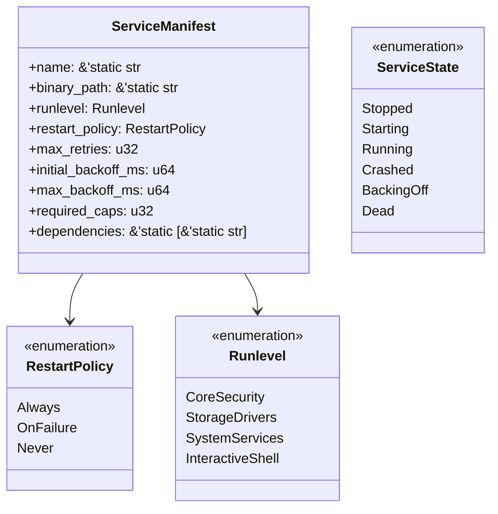

# Ind OS Userspace Init System Specification
**Document ID:** `INDOS-SPEC-INIT-01`  
**Phase:** Phase 5 (Userspace & the Developer OS)  
**Sprint:** SP-32  
**Status:** DRAFT / RATIFIED FOR SP-32  
**Requirements Traceability:** `REQ-USE-201`  
**Target Invariants:** `INV-INIT-001` (Deterministic Dependency Ordering), `INV-INIT-002` (Crash-Restart Containment & Exponential Backoff)

---

## 1. Executive Summary & Purpose

In a microkernel operating system like Ind OS, the kernel does not run high-level system services, network stacks, or device managers in supervisor mode. Instead, immediately following kernel boot and HAL initialization, the microkernel spawns the root user process (**PID 1: `init`** / `indus-init`).

`INDOS-SPEC-INIT-01` specifies the architecture and state machines of Ind OS `init`:
1. **Declarative Service Manifests:** Static, verifiable descriptions of every system service, declaring executable paths, runlevels, restart policies, and mandatory capability grants.
2. **Topological Dependency Graph (`INV-INIT-001`):** Strict Directed Acyclic Graph (DAG) resolution with cycle detection ensuring zero race conditions during system bring-up.
3. **Supervision & Exponential Backoff (`INV-INIT-002`):** Fault-tolerant service supervision with bounded retries and exponential delay to isolate and contain service crashes without destabilizing the system.
4. **Structured Boot Stage Mirroring:** Structured capture and broadcast of service state transitions to system telemetry and persistent audit storage.

---

## 2. Declarative Service Manifest Schema (`REQ-USE-201`)



### 2.1 Manifest Definition
```rust
#[derive(Debug, Clone, Copy, PartialEq, Eq)]
pub enum RestartPolicy {
    Always,
    OnFailure,
    Never,
}

#[derive(Debug, Clone, Copy, PartialEq, Eq, PartialOrd, Ord)]
pub enum Runlevel {
    CoreSecurity = 0,     // Consent store, policy engine, audit bus
    StorageDrivers = 1,   // VirtIO-Blk, IndFS, VFS mounter
    SystemServices = 2,   // Network stack, device manager, telemetry
    InteractiveShell = 3, // IndUS terminal shell, user session
}

#[derive(Debug, Clone, Copy, PartialEq, Eq)]
pub struct ServiceManifest {
    pub name: &'static str,
    pub binary_path: &'static str,
    pub runlevel: Runlevel,
    pub restart_policy: RestartPolicy,
    pub max_retries: u32,
    pub initial_backoff_ms: u64,
    pub max_backoff_ms: u64,
    pub required_caps: u32,
    pub dependencies: &'static [&'static str],
}
```

---

## 3. Dependency Resolution & Topological Ordering (`INV-INIT-001`)

Services declare explicit dependencies (e.g., `indus-shell` depends on `indfs-storage` and `console-driver`; `indfs-storage` depends on `virtio-blk`).

1. **DAG Invariant:** The dependency graph $G = (V, E)$ must be a Directed Acyclic Graph. Cycles (e.g., $A \to B \to A$) are detected during manifest validation and rejected with `InitError::DependencyCycleDetected`.
2. **Topological Sort:** Services are scheduled in order $\pi$ such that for every directed edge $(u, v) \in E$, $u$ starts strictly before $v$.
3. **Deterministic Staging:** Parallel bring-up respects dependency readiness barriers: dependent services do not receive spawn signals until dependency services transition to `ServiceState::Running`.

---

## 4. Crash-Restart State Machine & Exponential Backoff (`INV-INIT-002`)

```mermaid
stateDiagram-v2
    [*] --> Stopped
    Stopped --> Starting: Dependency Resolved
    Starting --> Running: Readiness Ping / Health OK
    Running --> Crashed: Non-Zero Exit / Fault Trap
    Running --> Stopped: Clean Exit (code 0)
    Crashed --> BackingOff: Retries < MaxRetries
    Crashed --> Dead: Retries >= MaxRetries (RestartPolicy::OnFailure)
    BackingOff --> Starting: Timer Expired (Backoff * 2)
    Dead --> [*]: Service Halted (Alert Dispatched)
```

### 4.1 Exponential Backoff Algorithm
When a service crashes unexpectedly:
1. Current retry count $r$ is incremented.
2. If $r > \text{max\_retries}$:
   - If `restart_policy == RestartPolicy::Always`, restart continues at $\text{max\_backoff\_ms}$.
   - Otherwise, service transitions to `ServiceState::Dead` and emits an alarm to the audit bus.
3. Backoff delay calculation:
   $$\text{backoff}(r) = \min(\text{initial\_backoff\_ms} \times 2^{r-1}, \text{max\_backoff\_ms})$$
4. Jitter and monotonically increasing timer prevention prevent thundering-herd problems across crashing services.

---

## 5. Structured Boot Stage Mirroring

`init` mirrors boot stages to structured records:
- `timestamp_ticks`: Monotonic timer offset.
- `service_name`: Identifier string.
- `old_state`: Previous `ServiceState`.
- `new_state`: Target `ServiceState`.
- `exit_code`: Process exit code (if applicable).
- `details`: Diagnostic metadata string.

Structured records are streamed directly to the Kernel Telemetry ring buffer (`REQ-KRN-113`) and `/dev/audit`.
