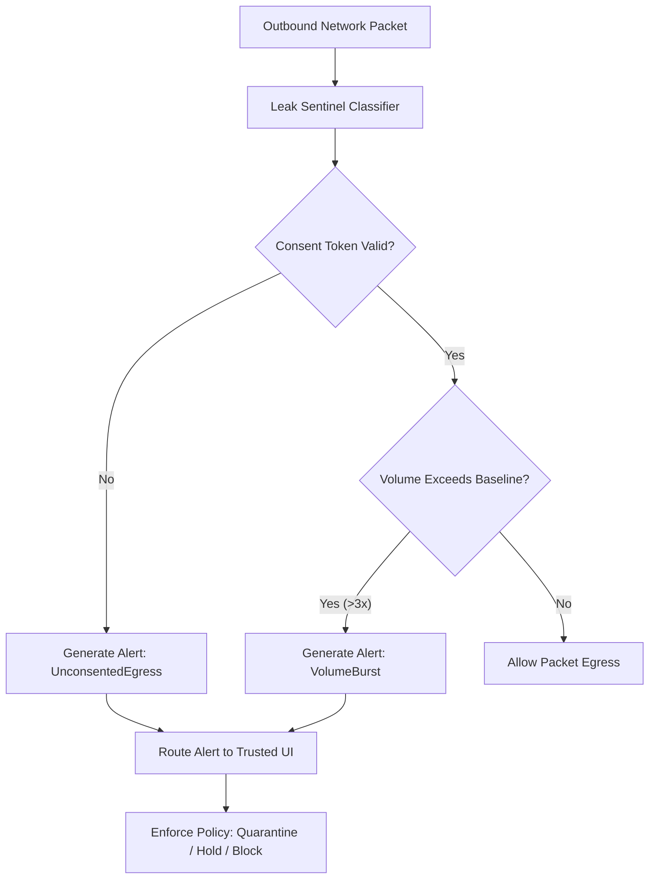

# Leak Sentinel Specification (REQ-AI-107 Network Half)

**Standard:** Ind OS Development Bible §6.3, §8.13, REQ-AI-107 network half  
**Status:** **RATIFIED**  
**Phase:** Phase 7 (SP-56)

---

## 1. Architectural Purpose & Scope

The **Network Leak Sentinel** monitors all outbound network flows traversing the Ind OS network stack to prevent unauthorized data exfiltration, covert telemetry, and unconsented background egress.

Unlike traditional host firewalls that only look at static port numbers, the Leak Sentinel operates in synergy with the Ind OS Intent Broker, Policy Engine V2, and Consent Broker V2. It validates whether outbound network flows possess explicit, verified user consent tokens and flags anomalous traffic patterns.

---

## 2. Architectural Invariants

- **INV-LEAK-001 (Flow Classification):** Every outbound network flow must be classified into either:
  1. `Consented`: Backed by a valid user consent card or standing policy.
  2. `SystemCritical`: Reserved for NTP, DHCP, or core update verifications.
  3. `Unconsented`: Egress attempted without authorization, generating an immediate anomaly alert.
- **INV-LEAK-002 (Out-of-Band Trusted UI Alerting):** Anomaly alerts must be routed directly to the trusted UI out-of-band. Alerts cannot be suppressed, intercepted, or filtered by ambient userspace applications.
- **INV-LEAK-003 (Zero Silent Blocking):** The sentinel must not silently discard or mutate packets without generating an auditable anomaly record and notifying the user. Actions are governed by explicit policy: `AlertOnly`, `HoldForConsent`, or `Quarantine`.
- **INV-LEAK-004 (Statistical Baseline Monitoring):** Continuous tracking of per-flow egress volume and packet frequencies to detect volume bursts (>3x baseline) and covert low-and-slow beaconing.

---

## 3. Data Structures & Flow Lifecycle

---

## 4. Anomaly Types

1. **`UnconsentedEgress`:** An application attempts to open an outbound socket or transmit packets without holding a valid `KernelConsentCard` or policy authorization.
2. **`VolumeBurst`:** A consented stream suddenly exceeds 3x its historical baseline egress rate, signaling potential bulk exfiltration.
3. **`CovertBeaconing`:** Periodic, rhythmic small packets transmitted to external non-system endpoints, indicating command-and-control heartbeats.

---

## 5. Security & Isolation

- Implemented in `indus-net` userspace and verified via in-kernel harness `leak_sentinel.rs`.
- Zero heap allocation in classification path.
- In-memory bounded circular alert ring buffer (capacity: 16 alerts).
